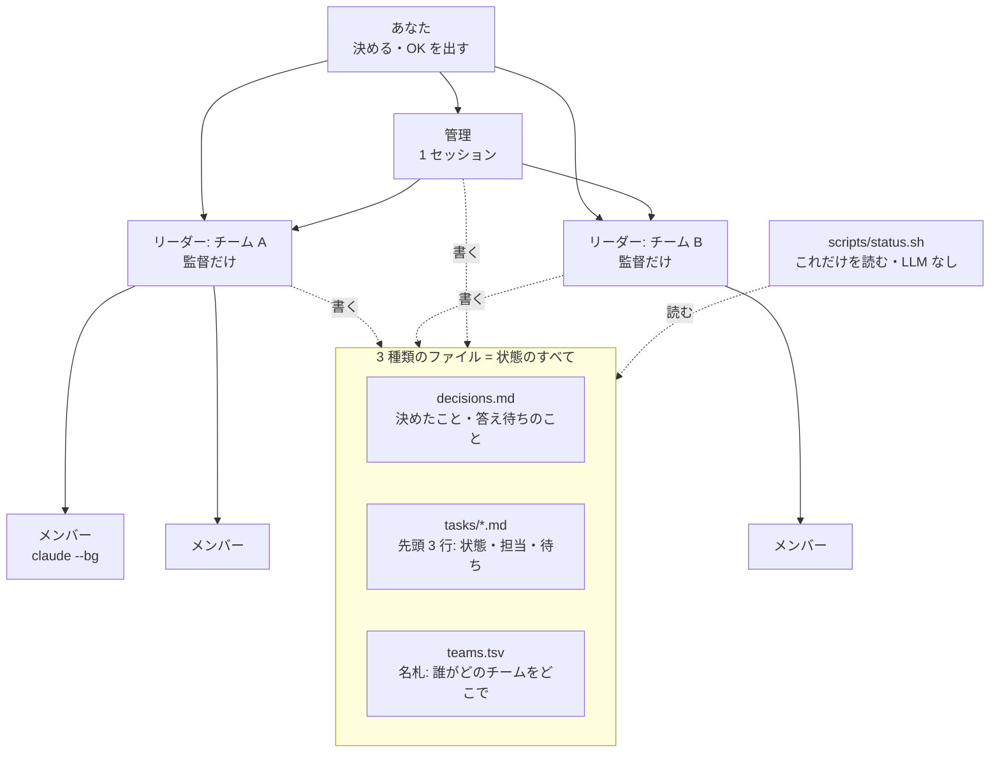

# AI Team Org（AI チームの組織テンプレート）

[English](README.md)

Claude Code のセッションで組織をまるごと 1 人で回すためのテンプレートです。管理役が 1 つ、チームごとにリーダーが 1 つ、手を動かすメンバーは必要なだけ。引き継ぎ書は一度も書きません。

- **1 人で、いくつものチーム。** あなたが話すのは管理役と数人のリーダーだけ。リーダーは監督に専念し、作業はメンバー（バックグラウンドのセッション）がします。
- **引き継ぎ書いらず。** 新しく入る人も、交代する人も、新しいセッションも、1 行貼るだけで入れます。必要なことは、作業するセッションがその都度直す小さなファイル 3 種類に全部あります。形が崩れたファイルは `status.sh` が警告します。
- **全体の状態が 1 画面で。** `scripts/status.sh` が、全チーム・進行中の仕事・動いているメンバー・答え待ちの質問を出します（小さな組織で約 0.5 秒・実測）。LLM を使わないので費用はゼロ。ファイルに書いてあることだけを出し、読めなかったときは読めなかったと出します。
- **OK を待つべき少しのことに安全網を。** PR・push・全体のテストは、よくある書き方なら hook が止めます。あなたが自分でそのリポジトリとブランチを解除するまでです。文章の決まりがすり抜ける誤操作を止める補助で、鍵ではありません（`hooks/README.md`）。

## 始め方

このリポジトリを clone し、その中で Claude Code を開いて、次の 1 行を貼ります。

```
Read JOIN.md in this repo and do what it says.
```

（日本語なら「このリポジトリの JOIN.md を読んで、そのとおりにやって」でも同じです。）使っているアカウントと受け持つチームを聞かれ、準備をしてリーダーのセッションを立ち上げます。次に入る人も同じ 1 行で入れます。

### 初めての 1 回: 1 チーム・1 仕事

最初の準備が終わりまでどう進むかの例です。この組織のリポジトリ（これ）を `~/org` に clone し、チームが作業する製品はローカルの clone `~/src/shop`（メインのブランチ `main`）、チーム名は `web` とします。名前は自分のものに置きかえてください。

1. **管理役。** `~/org` で Claude Code を開き、上の 1 行を貼ります。アカウントとリポジトリ（`~/src/shop`・`main`）を聞かれます。hook が入っていなければ入れ（設定の変更は先に見せます）、リーダーの作業フォルダ `~/worktrees/web-lead` を `main` から新しいブランチ `team/web` で作り、そこにチームの憲章と `decisions.md` を書き、`teams.tsv` に `web` の行を足します。このセッションはそのまま `~/org` で管理役になります。
2. **リーダー。** 管理役がリーダーを立ち上げます。できない環境なら、`cd ~/worktrees/web-lead && claude`（既定以外のアカウントなら前に `CLAUDE_CONFIG_DIR=…`）の後に貼るブロックを出します。リーダーの最初のコマンド `gh pr create --help` が止められれば、そのアカウントで hook が効いています。
3. **最初の仕事。** やってほしいことをリーダーに伝えます。リーダーは自分の作業フォルダで指示書 `docs/teams/web/tasks/<仕事>.md` をコミットし、そのコミットからメンバーの worktree `~/worktrees/web-<仕事>` を作り、`scripts/member-launch.sh` でメンバーを立ち上げます。
4. **見る。** `~/org` で `scripts/status.sh` を実行すると、仕事が `active`、メンバーが「Running members」に出ます。`scripts/member-status.sh "<メンバー名>"` で最後の報告が読めます。
5. **OK。** 結果を試して良ければ、リーダーの作業フォルダでターミナルを開き `~/.claude/hooks/human-ok.sh` を実行します。そのリポジトリとブランチからの PR・push が 6 時間だけ通ります。

## 全体の形



| ファイル | 書く人 | 中身 |
|---|---|---|
| `docs/teams/<チーム>/decisions.md` | リーダー（決定 1 つにつき 1 行） | あなたの決定と、答え待ちの質問（`- OPEN …`） |
| `docs/teams/<チーム>/tasks/<仕事>.md` | リーダー | 1〜3 行目: `Status` / `Owner` / `Waiting on`。その下はメンバーへの指示書 |
| `teams.tsv` | 入る人・抜ける人 | リーダー 1 人 1 行: チーム・セッション名・アカウント・作業フォルダ・ブランチ・憲章 |

ほかには、チームごとに 4 項目だけの憲章（`docs/teams/<チーム>.md`）があります。細かい形は [CONVENTIONS.md](CONVENTIONS.md) にあります。

チームの文書は、そのチームが作業するリポジトリ（各チームの worktree）に置きます。このリポジトリには道具と `teams.tsv` を置きます。例のチームはすぐ試せるように、このリポジトリの中にあります（`workdir` = `.`）。

## 中身

| パス | 何か |
|---|---|
| `JOIN.md` | セッションが入るときにたどる手順（最初の準備・新しい人・交代・並行） |
| `CONVENTIONS.md` | 役割とファイルの正確な形 |
| `teams.tsv` | 名札。例の行が 1 つ入っています |
| `org.env.example` | パソコンごとの設定（メンバーのアカウント・worktree の置き場）。`org.env` に写して使う |
| `docs/teams/example.md`・`docs/teams/example/` | 憲章・決定・仕事の例 |
| `docs/WHY.md`・`docs/WHY.ja.md` | それぞれがなぜこの形なのか |
| `scripts/status.sh` | 全体の状態を 1 画面で。bash と標準の道具だけ（`claude` と `jq` があれば、動いているメンバーも出る。無ければ「確認できない」と理由を出す） |
| `scripts/member-launch.sh` | アカウント・worktree・指示書を確かめてから `claude --bg` でメンバーを立ち上げる。`--bg` が使えない環境では `--dry-run` で貼るプロンプトを出す |
| `scripts/member-status.sh` | メンバーの一覧と、最後の報告 |
| `hooks/` | PR・push・全体のテストを、よくある書き方なら、あなたが自分のターミナルでそのリポジトリとブランチを解除するまで止める PreToolUse の hook（回帰テストつき） |

必要なもの: Claude Code・git・bash。hook・メンバーのスクリプト・「動いているメンバー」には `jq`。

## 試す

```bash
cp org.env.example org.env          # MEMBER_CONFIG_DIR を書く（例 ~/.claude）
scripts/status.sh                   # 例のチームが出る。警告があれば終了コード 1
bash hooks/test-human-gate.sh       # hook の回帰テスト（push などは実際にはしない）
scripts/member-launch.sh --help
```

## なぜうまくいくのか

短く書くと次のとおりです（先に何を試してどう失敗したかまで書いた長い版は [docs/WHY.ja.md](docs/WHY.ja.md)）。

- **「今の状態」の文書を作らない。** 状態の文書は書いた瞬間から古くなり、新しいセッションはそれを丸ごと信じます。状態は、作業そのものが変える場所（仕事の先頭 3 行と決定の 1 行）にだけ置くので、別に更新し忘れるものがありません。
- **仕事ごとに先頭 3 行だけ。** 直すのがタダ同然なほど小さく、スクリプトが読めるほど形が決まっています。状態を変えるのは 3 行の書き換えで、ページの書き直しではありません。
- **状態を LLM で作らない。** モデルのまとめは毎回違い、毎回トークンがかかり、もっともらしく間違えます。決まった形を読むスクリプトは、間違えるときも目に見える形で間違えます。
- **リーダーは監督だけ。** 自分でもコードを書くリーダーは全体を見失い、細部でコンテキストを使い切ります。計画・指示書・確認・決定の記録だけにすると長持ちし、きれいに交代できます。
- **お願いだけでなく hook も。** 「PR は私の OK の後に」は 3 回書いても破られました。hook は設定した道具のコマンドの前に毎回動くので、長いセッションの終わりでも、よくある誤操作を止めます。全部は止められないので、文章の決まりも残します。
- **worktree は決まった 1 か所に。** アプリのフォルダの中に作った worktree が、自動の片付けで作業ごと消えました。その外に、自分で決めた置き場を 1 つ。そこまでは片付けが届きません。
- **メンバーのアカウントは 1 か所で決める。** 違うアカウントで立ち上がったメンバーは、ずっと後になって分かりにくい形で失敗します。設定は 1 つ、立ち上げる前に毎回確かめて表示します。

## ライセンス

[MIT](LICENSE)
