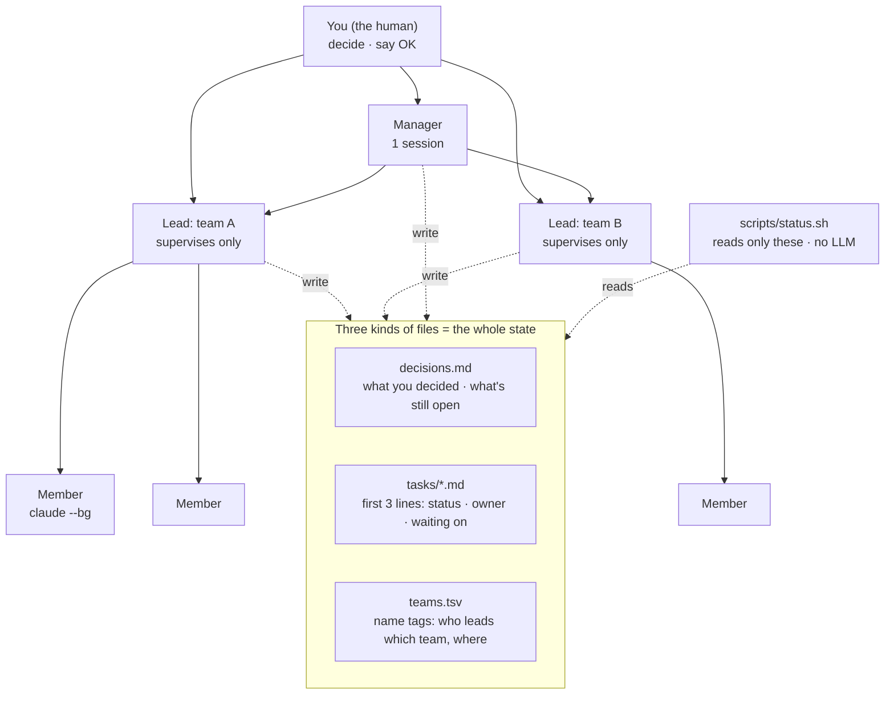

# AI Team Org

[日本語](README.ja.md)

Run a whole organisation of Claude Code sessions as one person — a manager, a lead per team, and as many members as the work needs — without ever writing a handoff note.

- **One person, many teams.** You talk to one manager and a handful of leads. Leads only supervise; members (background sessions) do the work.
- **No handoff notes.** Anyone — a new person, a replacement, a fresh session — joins by pasting one line. Everything they need is in three kinds of small files that the sessions update as they work — and `status.sh` warns when one of them breaks the format.
- **The whole state on one screen.** `scripts/status.sh` shows every team, open task, running member and open question (about half a second for a small org, measured). No LLM, so it costs nothing and reports only what the files say — and says so when it can't read something.
- **A safety net for the few things that wait for your OK.** Pull requests, pushes and the full test gate are caught by a hook in their usual forms, until you unlock that repository + branch yourself. It catches slips that written rules miss; it is not a lock (see `hooks/README.md`).

## Start

Clone this repo, open Claude Code in it, and paste:

```
Read JOIN.md in this repo and do what it says.
```

It asks which account you use and which team you're taking, sets things up, and starts the lead sessions. The same line works for the next person who joins.

### First run: one team, one task

What the first setup looks like end to end. Here the org repo (this one) is cloned to `~/org`, the product the team works on is a local clone at `~/src/shop` with main branch `main`, and the team is `web` — use your own names.

1. **Manager.** Open Claude Code in `~/org` and paste the line above. It asks for your account and for the repository (`~/src/shop`, `main`), installs the hook if it's missing (showing you the settings change first), creates the lead's workdir `~/worktrees/web-lead` on a new branch `team/web` from `main`, writes the team's charter and `decisions.md` there, and adds the `web` row to `teams.tsv`. That session stays in `~/org` as the manager.
2. **Lead.** It starts the lead — or prints a block for you to paste after `cd ~/worktrees/web-lead && claude` (with `CLAUDE_CONFIG_DIR=…` in front for a non-default account). The lead's first command, `gh pr create --help`, must be refused: that proves the hook is on for that account.
3. **First task.** Tell the lead what you want. It commits a brief `docs/teams/web/tasks/<task>.md` in its own workdir, creates the member's worktree `~/worktrees/web-<task>` from that commit, and starts the member with `scripts/member-launch.sh`.
4. **Watch.** `scripts/status.sh` in `~/org` shows the task as `active` and the member under "Running members". `scripts/member-status.sh "<member name>"` prints its final report.
5. **OK.** When you've tried the result and agree, open a terminal in the lead's workdir and run `~/.claude/hooks/human-ok.sh`. Pull requests and pushes from that repository + branch are allowed for 6 hours.

## How it fits together



| File | Who writes it | What it holds |
|---|---|---|
| `docs/teams/<team>/decisions.md` | the lead, one line per decision | your decisions and open questions (`- OPEN …`) |
| `docs/teams/<team>/tasks/<task>.md` | the lead | lines 1–3: `Status` / `Owner` / `Waiting on`; below: the brief a member works from |
| `teams.tsv` | whoever joins or leaves | one row per lead: team, session, account, workdir, branch, charter |

The rest of a team's context is a four-point charter (`docs/teams/<team>.md`). The details are in [CONVENTIONS.md](CONVENTIONS.md).

Team docs live in the repo the team works on (in each team's worktree). This repo holds the tools and `teams.tsv`; the example team lives right here so you can try it (`workdir` = `.`).

## What's inside

| Path | What it is |
|---|---|
| `JOIN.md` | The steps a session follows to join (first setup, new person, takeover, parallel). |
| `CONVENTIONS.md` | Roles and the exact file formats. |
| `teams.tsv` | Name tags. Ships with one example row. |
| `org.env.example` | Per-machine settings: the member account, where worktrees live. Copy to `org.env`. |
| `docs/teams/example.md`, `docs/teams/example/` | An example charter, decisions file and task. |
| `docs/WHY.md` | Why each piece is the way it is. |
| `scripts/status.sh` | The whole state on one screen. bash + standard tools; `claude` and `jq` optional (without them, "Running members" says it can't check, and why). |
| `scripts/member-launch.sh` | Starts a member with `claude --bg`, after checking account, worktree and brief. `--dry-run` prints a prompt to paste where `--bg` isn't available. |
| `scripts/member-status.sh` | Lists members, prints a member's final report. |
| `hooks/` | A PreToolUse hook that catches PRs/pushes/the full gate in their usual forms until you unlock that repository + branch from your own terminal, with regression tests. |

Requirements: Claude Code, git, bash. `jq` for the hook, the member scripts and the "running members" section.

## Try it

```bash
cp org.env.example org.env          # set MEMBER_CONFIG_DIR (e.g. ~/.claude)
scripts/status.sh                   # shows the example team; exit 1 if there are warnings
bash hooks/test-human-gate.sh       # the hook's regression tests (nothing is pushed)
scripts/member-launch.sh --help
```

## Why it works

The short version (the long one, with what went wrong first, is [docs/WHY.md](docs/WHY.md)):

- **No "current status" document.** Status documents go stale the moment they're written and every new session trusts them. The state lives where the work changes it — task headers and decision lines — so there's nothing separate to forget to update.
- **Exactly three header lines per task.** Small enough that updating them is free, fixed enough that a script can read them. Changing state means editing three lines, not rewriting a page.
- **Status without an LLM.** A summary made by a model can differ between runs, costs tokens every time, and can be wrong in a convincing way. A script reading fixed formats can only be wrong in visible ways.
- **Leads only supervise.** A lead that also writes code loses the overview and fills its context with details. Keeping it to plans, briefs, reviews and decisions means it lasts longer and can be replaced cleanly.
- **Hooks, not only reminders.** "Wait for my OK before opening a PR" was written down three times and still broken. A hook is checked before every command it is set up for, so the usual slip gets caught even late in a long session. It doesn't catch everything, so the written rule stays too.
- **Worktrees in one fixed place.** Worktrees inside the app's own folder were removed by its automatic cleanup, work included. One root you choose, outside that folder, so the cleanup doesn't reach it.
- **One place for the member account.** Members started on the wrong account fail late and confusingly. One setting, checked and printed before every launch.

## License

[MIT](LICENSE)
